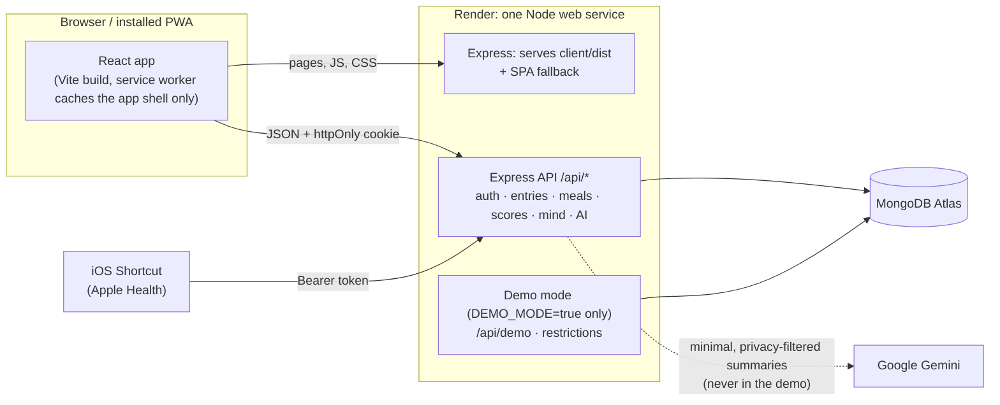

# Daily Tracker

A personal web app for tracking mood, meals, weight, learning and reflection every day, with AI encouragement along the way.

## Live demo

**[Try the demo →](https://YOUR-DEMO-SERVICE.onrender.com)** (no sign-up)

"Try the demo" creates a fresh, temporary account filled with 60 days of made-up sample data. Everything works on your own copy, and it's deleted automatically after 24 hours. Please don't enter personal information. The free server sleeps when idle, so the first visit can take up to a minute. See [How the demo works](#how-the-demo-works).

### Highlights

- **Today as a timeline**: mood check-ins, water, workouts, learnings, good things and more, each with its own time
- **Daily purpose**: what today is about, intentions to tick off and an evening reflection
- **Scores and trends**: physical, mental and learning scores with a clear breakdown; weight, calories, sleep and water charts; a weekly review comparing this week with the last
- **Meals and calories** against a daily target worked out from your profile, with macros and fibre
- **Mind**: an encrypted diary, a step-by-step CBT thought log, "Lift me up" and box breathing
- **Apple Health sync** through an iOS Shortcut: steps, workouts, and sleep stages with a calculated sleep score
- **Gentle AI encouragement** (Gemini) with strict privacy rules, and always-visible support helplines
- **Installable PWA**, accessible, with light and dark themes

### Screenshots

<!-- Add images to docs/screenshots/ and they'll show here -->

| Dashboard | Today | Weekly review |
| --------- | ----- | ------------- |
|  |  |  |

| Meals | Thought log | Phone |
| ----- | ----------- | ----- |
|  |  |  |

## Features

| Status | Feature |
| ------ | ------- |
| ✅ | Project setup: React client, Express API, MongoDB Atlas connection, health check page |
| ✅ | Login and user accounts (bcrypt passwords, JWT in an httpOnly cookie, protected routes) |
| ✅ | Profile with BMR, TDEE, daily calorie target (with a safe minimum), BMI and weeks-to-goal |
| ✅ | Today as a timeline: quick mood check-ins, workouts, mental and outdoor activities, good things, learnings and present moments, each with its own time; body values; intraday mood and step graphs |
| ✅ | 30-day history and check-in streaks |
| ✅ | Meal and calorie logging against the daily target |
| ✅ | Daily mental, physical and learning scores |
| ✅ | Weight trend chart with a 7-day moving average |
| ✅ | Encrypted diary |
| ✅ | CBT-style thought log |
| ✅ | Gemini AI encouragement |
| ✅ | Apple Health sync via iOS Shortcuts, including sleep and a calculated sleep score |
| ✅ | Installable PWA, deployed on Render as one web service |

## Tech stack

- **Frontend:** React 19, Vite, TypeScript, Tailwind CSS v4, shadcn/ui (Radix), Recharts, lucide icons, React Router; installable as a PWA (vite-plugin-pwa)
- **Backend:** Express 5, TypeScript, Mongoose, zod validation, helmet (strict CSP), JWT in an httpOnly cookie
- **Database:** MongoDB Atlas (diary, thought-log and purpose text encrypted with AES-256-GCM)
- **AI:** Google Gemini, behind privacy rules and pre-written fallbacks
- **Tests:** Vitest (unit tests, plus integration tests against an in-memory MongoDB)
- **Hosting:** Render (one web service: Express serves the API and the built client)

## Architecture



## Project structure

```
daily-tracker/
├── package.json         # build and start scripts for production (Render)
├── render.yaml          # Render Blueprint: one web service
├── client/              # React + Vite frontend
│   ├── public/
│   ├── src/
│   │   ├── components/  # shared components, e.g. ProtectedRoute
│   │   ├── context/     # AuthProvider and the useAuth hook
│   │   ├── lib/api.ts   # fetch wrapper for the API
│   │   ├── pages/       # Login, Register, Dashboard
│   │   ├── App.tsx      # routes
│   │   └── main.tsx
│   ├── pwa-assets.config.ts # app icons, made from public/favicon.svg
│   └── vite.config.ts   # proxies /api to the server; PWA manifest and service worker
└── server/              # Express + Mongoose API
    ├── src/
    │   ├── config/      # env validation, MongoDB connection
    │   ├── controllers/ # request handlers
    │   ├── middleware/  # requireAuth, rate limiting, error handling
    │   ├── models/      # Mongoose models
    │   ├── routes/      # /api/health, /api/auth
    │   ├── types/       # Express type extensions
    │   ├── utils/       # JWT and cookie helpers, AppError
    │   ├── app.ts       # Express app setup
    │   └── index.ts     # entry point
    └── .env.example     # template for environment variables
```

## Getting started

### Prerequisites

- [Node.js](https://nodejs.org/) 22.12 or later, with npm
- A [MongoDB Atlas](https://www.mongodb.com/atlas) cluster (the free tier works) and its connection string

### Install

```bash
git clone https://github.com/<your-username>/daily-tracker.git
cd daily-tracker

cd server && npm install
cd ../client && npm install
```

### Configure environment variables

Copy the example file and fill in your own values:

```bash
cp server/.env.example server/.env
```

| Variable | Description |
| -------- | ----------- |
| `PORT` | Port for the Express server (default `4000`; Render sets it) |
| `NODE_ENV` | `development` or `production`. In production the server also serves the client, cookies are HTTPS-only and errors hide details. |
| `MONGODB_URI` | Your MongoDB Atlas connection string |
| `JWT_SECRET` | A random string of at least 32 characters, used to sign login tokens |
| `DIARY_ENCRYPTION_KEY` | Exactly 64 hex characters; encrypts diary and thought-log text. Back it up: if it's lost, that text can't be read. |
| `ALLOW_REGISTRATION` | `true` to allow new sign-ups. Anything else closes registration. |
| `CLIENT_URL` | Development only: the Vite dev server, allowed by CORS (e.g. `http://localhost:5173`) |
| `GEMINI_API_KEY` | Google AI Studio key for AI encouragement. Optional in development (pre-written messages instead), required in production. |
| `GEMINI_MODEL` | Gemini model, e.g. `gemini-2.5-flash`. Required in production. |
| `AI_DATA_MODE` | `minimal` (numbers and categories only) or `full` (thought-log text too, never private logs or the diary). Required in production. |
| `AI_DAILY_LIMIT` | AI calls per user per day (default `20`) |
| `DEMO_MODE` | `true` only for the public demo deployment (see [How the demo works](#how-the-demo-works)). Leave it unset everywhere else. |
| `DEMO_REPO_URL` | Demo only: the GitHub repository linked from the demo banner and footer |

The server checks these at startup and stops with a clear message if any are missing or invalid.

`server/.env` is git-ignored. Never commit real credentials.

### Run

Start each server in its own terminal:

```bash
# Terminal 1: API on http://localhost:4000
cd server
npm run dev
```

```bash
# Terminal 2: client on http://localhost:5173
cd client
npm run dev
```

Open http://localhost:5173 and create an account, or log in. Vite forwards every `/api` request to the server. You can check the server and database at http://localhost:4000/api/health.

### API

| Method | Path | Description |
| ------ | ---- | ----------- |
| GET | `/api/health` | Server and database status |
| POST | `/api/auth/register` | Create an account (only when `ALLOW_REGISTRATION=true`) |
| POST | `/api/auth/login` | Log in; sets the `token` cookie (10 attempts per 15 minutes) |
| POST | `/api/auth/logout` | Clear the `token` cookie |
| GET | `/api/auth/me` | Current user (requires login) |
| GET | `/api/profile` | Profile fields (requires login) |
| PUT | `/api/profile` | Update profile fields; `null` clears a field (requires login) |
| GET | `/api/profile/summary` | Age, BMR, TDEE, calorie target, BMI and weeks to goal, or which fields are missing (requires login) |
| GET | `/api/entries?from=&to=` | Entries in a date range, newest first (default: last 30 days, max 366) |
| GET | `/api/entries/today` | Today's day (Asia/Colombo date), as for `GET /api/entries/:date` |
| GET | `/api/entries/:date` | The day's `entry` (or `null`), a chronological `timeline` of everything logged, and the intraday `healthSnapshots` |
| PUT | `/api/entries/:date/daily` | Set `weightKg`, `steps`, `activeCalories` by hand (always replaces; `null` clears) |
| POST | `/api/entries/:date/:kind` | Add one entry; optional `time` ("HH:mm") back-fills it to earlier that day |
| PATCH | `/api/entries/:date/:kind/:id` | Change some fields of one entry (`null` clears an optional field) |
| DELETE | `/api/entries/:date/:kind/:id` | Delete one entry |
| DELETE | `/api/entries/:date` | Delete the whole day |
| GET | `/api/entries/stats/streak` | Current and longest logging streak |
| GET | `/api/demo/config` | Demo only: `{ enabled, repoUrl, ttlHours }` (404 when `DEMO_MODE` isn't `true`) |
| POST | `/api/demo/start` | Demo only: create a temporary account with sample data and log in (5 per IP an hour) |

`kind` is `moods`, `workouts`, `mental`, `outdoor`, `goodThings`, `learnings` or `presentMoments`. Every entry has its own `id` and a `loggedAt` time. Future dates and times are rejected. Workouts from Apple Watch are replaced by each sync, so they can't be edited by hand.

All `/api/entries` routes require login and only ever return the logged-in user's own entries.

#### Steps and active calories only go up

A day's totals only grow, so an Apple Health sync replaces `steps` or `activeCalories` only when the new number is **higher** than what's stored (a lower one is reported back as `keptFields`). Each sync that changes them also adds a `{ time, steps, activeCalories }` point to `healthSnapshots` for the "through the day" chart. Typing a value on the Today page always replaces it, so a wrong number can be fixed.

### Migrating older data

Data saved before the timeline model (one mood per day, a single present moment, good things as plain text) is converted with:

```bash
cd server
npm run migrate:timeline -- --dry-run   # only count what would change
npm run migrate:timeline                # convert
```

It's safe to run twice: days already converted are left alone.

### Tests

```bash
cd server
npm test
```

Unit tests (Vitest) cover the calculations, scores, sleep, validation, AI privacy rules, Apple Health merging, environment checks and how production serves the client.

Integration tests (`server/src/demo/*.test.ts`) run the real app against an in-memory MongoDB. They check demo mode end to end, and that nothing changes when it's off. The first run downloads a MongoDB binary (several hundred MB, cached in `~/.cache/mongodb-binaries` afterwards). The tests set every environment variable themselves and never read `server/.env` values for the database or AI.

## Deploying to Render

The app runs as **one web service**. In production (`NODE_ENV=production`) Express serves the built client from `client/dist`, sends `index.html` for every page outside `/api`, and keeps the API under `/api`. The app and the API share one address, so no CORS setup is needed.

### Try a production build locally

```bash
npm run build                       # installs and builds the client and the server
NODE_ENV=production PORT=4100 npm start
```

On Windows PowerShell: `$env:NODE_ENV="production"; $env:PORT="4100"; npm start`

Open http://localhost:4100. The server reads `server/.env`; in production mode it also needs `GEMINI_API_KEY`, `GEMINI_MODEL` and `AI_DATA_MODE`.

> If MongoDB reports `querySrv ECONNREFUSED` locally: the public-DNS workaround for `mongodb+srv://` only runs in development, and some home networks block those lookups. It works on Render.

### Deploy

1. Push the repo to GitHub.
2. In [MongoDB Atlas](https://cloud.mongodb.com/) → **Network Access**, allow `0.0.0.0/0`. Render's free plan has no fixed IP address, so a strong database password is your protection.
3. On [Render](https://dashboard.render.com/): **New → Blueprint**, then pick the repo. Render reads `render.yaml`: a Node web service in Singapore on the free plan, built with `npm run build`, started with `npm start`, with `/api/health` as the health check.
4. Render asks for each environment variable marked `sync: false`; fill them in (see the table above). Use **new** random values for `JWT_SECRET`. Use the **same** `DIARY_ENCRYPTION_KEY` as before if the database already has diary entries.
5. Wait for the first deploy, then open `https://<your-service>.onrender.com`.
   If the database has data from before the timeline model, run `npm run migrate:timeline` against the production database once the new code is live (see [Migrating older data](#migrating-older-data)).
6. Apple Health sync: in the app, open **Profile → Apple Watch sync**, create a token, and point your iOS Shortcut at `https://<your-service>.onrender.com/api/health-sync`.

Every push to the main branch deploys again. The free plan sleeps after about 15 minutes without visits. The first visit after that can take up to a minute, and the app shows a "Waking up the server…" screen meanwhile.

### Install the app on your phone

- **iPhone (Safari):** Share → **Add to Home Screen**.
- **Android (Chrome):** menu → **Install app**.

The service worker caches only the app shell (HTML, JS, CSS, icons and fonts), so the app opens quickly. API responses are never cached: your data always comes fresh from the server. When a new version is deployed, a "New version available" toast offers a **Refresh** button.

To change the icon, edit `client/public/favicon.svg` and run `npm run generate-pwa-assets` in `client/`.

## How the demo works

The public demo is the **same code** deployed a second time, with `DEMO_MODE=true` and **its own database**. A personal deployment leaves `DEMO_MODE` unset, and then none of the following exists: no demo routes, no expiry on any data, no TTL indexes, no restrictions.

**Try the demo.** The login page shows **Try the demo — no sign-up**. Normal registration stays closed, even if `ALLOW_REGISTRATION=true`. `POST /api/demo/start`:

1. creates a new account with a friendly name ("Demo Explorer") and a made-up `@demo.invalid` address that nobody can log in with;
2. fills it with about 60 days of sample data ending today, with the same generator as `npm run seed:demo` (`server/src/scripts/demoData.ts`):
   - check-ins with several mood logs a day, workouts, water, sleep with stages and scores, steps and calories through the day
   - good things, learnings and present moments
   - meals with macros and fibre
   - daily purposes with intentions and reflections
   - a purpose statement and values, weekly goals, a few diary entries and thought logs (all neutral, made-up content)
3. logs the visitor in for 24 hours.

**Everything expires after 24 hours.** Every document belonging to a demo account carries `expiresAt`: the account's own creation time plus 24 hours, covering both the sample data and whatever the visitor adds. At startup the demo server:

- creates a MongoDB **TTL index** on `expiresAt` in every collection that holds user data, so Atlas deletes expired accounts and their data by itself, even while the server sleeps;
- deletes anything already expired.

An expired account's login stops working straight away.

**Limits.** 5 demo starts per IP address an hour. At 300 active demo accounts, new visitors see "The demo is busy right now. Please try again a little later."

**Turned off in the demo (refused by the server):**

- the AI: every AI feature shows pre-written example replies, and Gemini is never contacted (no key is needed)
- Apple Health sync and its tokens (all of `/api/health-sync`)
- deleting data before the journey start
- changing email or password, deleting the account, and data export: these routes are blocked in advance, so adding them later can't open them in the demo

**In the app.** Every page shows a slim banner: "You're exploring a demo with sample data. It's deleted after 24 hours — please don't enter personal information", with a link to the GitHub repo. The footer says "Built by Routhiran · GitHub". The support card adds a link to [findahelpline.com](https://findahelpline.com) for visitors outside Sri Lanka.

### Deploying the demo

Create it as a **separate** Render web service, so your own deployment is never touched. Don't add it to `render.yaml`.

1. In MongoDB Atlas, create a **new database** for the demo: a new database name in the connection string, or a separate (free) cluster. Never point the demo at your personal data.
2. On Render: **New → Web Service**, the same repo, Node, region Singapore, plan Free, build command `npm run build`, start command `npm start`, health check path `/api/health`.
3. Environment variables:

| Variable | Value |
| -------- | ----- |
| `NODE_ENV` | `production` |
| `DEMO_MODE` | `true` |
| `MONGODB_URI` | The demo's own database |
| `JWT_SECRET` | A new random value (not the one from your personal deployment) |
| `DIARY_ENCRYPTION_KEY` | A new random 64-hex-character key |
| `DEMO_REPO_URL` | Your GitHub repository URL |

The demo needs no `GEMINI_*`, `AI_DATA_MODE` or `ALLOW_REGISTRATION`.

## Roadmap

1. ✅ **Part 1:** Project setup, MongoDB connection, health check page
2. ✅ **Part 2:** Login and user accounts
3. ✅ **Part 3:** Profile and BMR/TDEE/calorie target calculations
4. ✅ **Part 4:** Daily check-in, history and streaks
5. ✅ **Part 5:** Meal and calorie logging, and daily mental, physical and learning scores
6. ✅ **Part 6:** Weight trend with 7-day average
7. ✅ **Part 7:** Diary and CBT-style thought log
8. ✅ **Part 8:** Gemini AI encouragement
9. ✅ **Part 9:** Apple Health sync via iOS Shortcuts
10. ✅ **Part 10:** PWA support and deployment on Render

## License

Released under the [MIT License](LICENSE).
